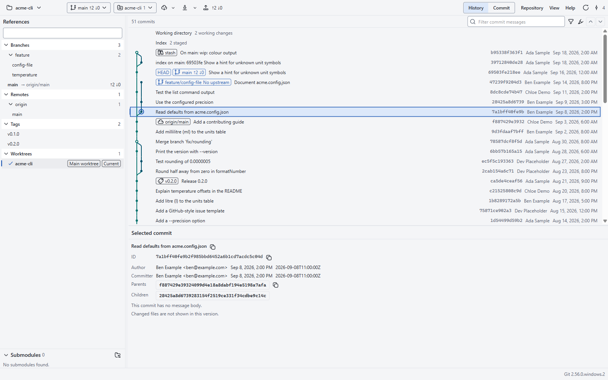
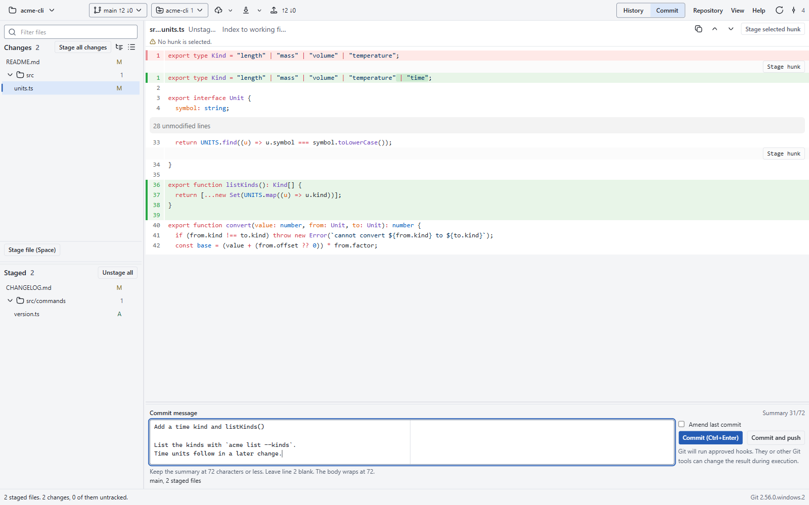

# Arbareto

Keyboard-first, local-first Git client for Windows and WSL.

## Screenshots

<picture>
  <source media="(prefers-color-scheme: dark)" srcset="docs/assets/screenshots/history-dark.png">
  
</picture>

## Status

- Arbareto is pre-release software. Expect missing features and changes.
- Windows comes first. The qualification target is Windows 11 x64. macOS and Linux come later.
- No installer release exists yet. Build the app from source.

## Features

These features work on the `main` branch today.

- History of the whole repository, with a commit graph in branch lanes and the details of the selected commit.
- Commit message search, with steps through the matches in the full graph.
- Working changes and a diff view. Stage and unstage files, folders, hunks, or selected lines.
- Commit, amend the last commit, and commit and push in one step.
- Fetch, pull, and push with the upstream branch. You choose the default pull mode. Ahead and behind counts show on each branch.
- Recovery from a rejected push, with force push with lease after a confirmation.
- Clone a repository.
- Branches: switch, create, rename, delete, merge, and rebase. Resolve a conflicted file, or open it in your merge tool.
- A sidebar with branches, remote-tracking branches, tags, worktrees, and submodules. Add and remove worktrees. Update submodules.
- Git settings by scope: system, global, and local.
- Repositories inside WSL 2 distros, through the Git of the distro.
- A repository trust prompt before Arbareto runs programs that the repository configures.
- Keyboard-first: shortcuts and keyboard focus for the main actions.
- System, light, and dark themes, with three dark palettes. The interface supports Windows contrast themes.

### Planned

- Changed files of a commit in the history view, blame, file delete, and an ignore editor.
- Spell check of the commit message.
- macOS and Linux builds.

## Requirements

- Windows 11 x64. Windows 10 x64 also runs, with the label "Unqualified platform".
- Git for Windows 2.55.0.windows.3 or later.
- For WSL repositories: WSL 2 and Git 2.55.0 or later inside the distro. Arbareto refuses WSL 1 distros.
- The Microsoft Edge WebView2 Runtime. The installer does not install it.

## Build from source

Install Bun 1.4.4, the Rust toolchain with the MSVC build tools, and the Tauri CLI (`cargo tauri`). Then use the commands in [Development](#development).

## Architecture

- A thin Tauri 2 shell in Rust. It owns the window, the native dialogs, and the process limits.
- A Git service in TypeScript, compiled with Bun into one executable. It runs the installed Git with argument arrays and bounded output.
- A React renderer. It has no shell access and sends only typed operations.
- Shared operation contracts with zod schemas. No Electron.

## Development

Run these commands from the repository root. Run `bun run build` before `cargo check`, because the Tauri build needs the frontend and the service binary.

- `bun install --frozen-lockfile`
- `bun run build`
- `bun run typecheck`
- `bun run export:schemas` writes the JSON Schema files in `src/contracts/schemas/` after a zod schema change. `bun run export:schemas --check` fails on a stale file.
- `bun run test:contracts`
- `bun run test:git`
- `bun run test:windows` (needs `bun run build:service` first; skips without the service binary)
- `bun run test:all` runs `tests/contracts`, `tests/git`, and `tests/wsl` in two steps: the parallel group, then the serial group of `tests/groups.json`. It fails when a test file is in no group or has no report. Set `ARBARETO_WSL_DISTRO` for the WSL tests. `ARBARETO_TEST_WORKERS` sets the worker count of the parallel step (default 8).
- `ARBARETO_HISTORY_FIXTURES` is a comma list of the large history fixtures that a run may build: `H200K`, `H1M`, or `H200K,H1M`. A named fixture builds when the cache does not hold it, and its cases run. When the variable does not name H200K, the H200K cases run only when the cache holds both H200K variants. When the variable does not name H1M, the H1M cases skip with the capability `history-fixture-h1m`. A skip never counts as a pass.
- `bun run test:fast` runs `tests/contracts` and the parser tests the same way, for edit loops.
- `cargo check --locked --manifest-path src-tauri/Cargo.toml`
- `cargo check --locked --manifest-path src-tauri/Cargo.toml --target x86_64-unknown-linux-gnu` (Linux portability check)
- `cargo test --locked --manifest-path src-tauri/Cargo.toml`
- Run the app for development: `bun run dev`
- `bun run package` builds an unsigned current-user NSIS installer in `src-tauri/target/x86_64-pc-windows-msvc/release/bundle/nsis/`. It does not install it. Then it prints the `rustc`, `cargo`, `cargo tauri`, `bun`, and NSIS versions for the build record.
- `pwsh -File scripts/windows/measure-ram.ps1 [-RootPid <pid>]` prints the private working set, private bytes, and working set of each process in the running app's tree, with totals per group (Tauri, Bun, WebView2); the main number is the private working set (Task Manager "Memory").

Cloud sessions: paste [.claude/cloud-setup.sh](.claude/cloud-setup.sh) into the cloud environment's setup script field. The cloud runs Bun and TypeScript work and the Linux portability check.

## Acknowledgements

The layout takes ideas from [Git Extensions](https://github.com/gitextensions/gitextensions) (GPL-3.0). Arbareto copies no code and no assets from Git Extensions.

## License

Arbareto is free software under the GNU Affero General Public License v3.0 or later (`AGPL-3.0-or-later`). See [LICENSE](LICENSE). [NOTICE.md](NOTICE.md) states the copyright and the section 7 additional terms. These terms require attribution and marked, renamed modified versions. They grant no trademark rights to the name "Arbareto". Third-party material keeps its own license. [third-party-licenses/](third-party-licenses/) holds the license texts that the shipped packages do not carry.

## Contributing and security

- Read [CONTRIBUTING.md](CONTRIBUTING.md) before you open a pull request.
- Report a vulnerability as [SECURITY.md](SECURITY.md) tells you. Do not open a public issue for it.
